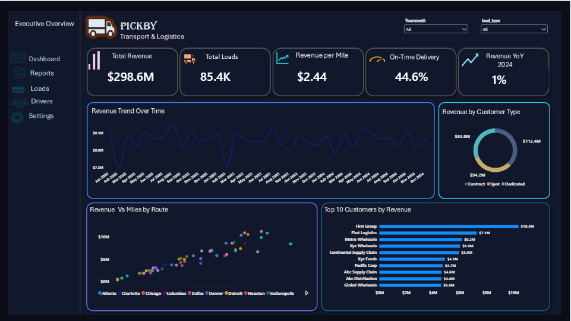
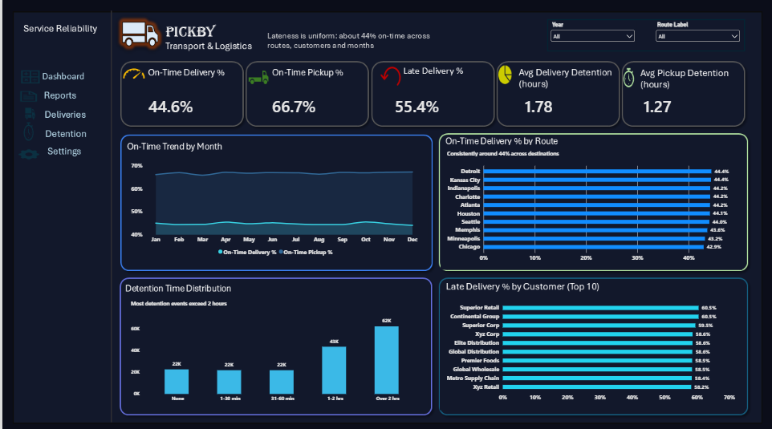
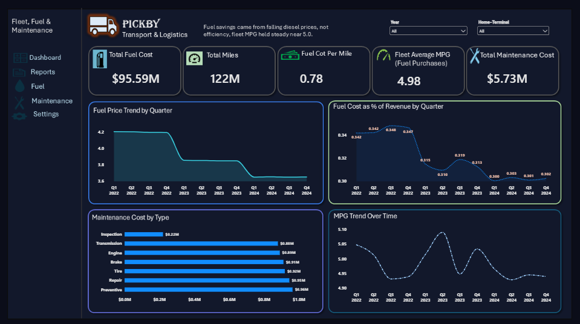
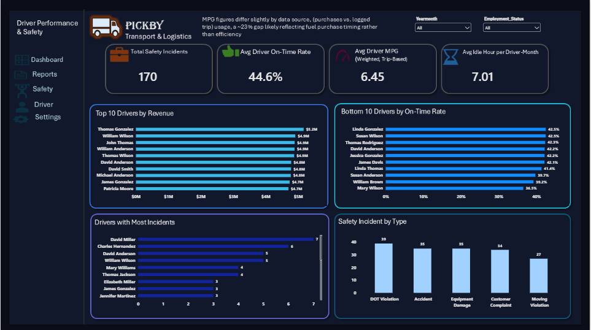

### PickBy-Transport-Logistics-Fleet-Analytics
An end-to-end Power BI analytics project analyzing revenue, service reliability, fleet efficiency, fuel costs, maintenance, driver performance, and safety for a fictional transportation and logistics company.

TS Academy Capstone Project

### Project Presentation

PickBy Transport & Logistics is a fictional trucking and logistics company operating across a fleet of trucks, trailers, drivers, routes, customers, and delivery facilities.

The company generates operational data across multiple areas of the business, including loads, trips, fuel purchases, maintenance, delivery events, driver performance, truck utilization, and safety incidents.

The objective of this project was to transform multiple raw CSV datasets into a structured analytical model in Power BI and use the resulting model to answer important business questions around:

* Revenue performance
* Service reliability
* Fleet and fuel efficiency
* Maintenance costs
* Driver performance
* Safety performance

The project follows an end-to-end data analytics workflow:

Raw CSV Data → Power Query → Data Cleaning → Data Modeling → DAX Measures → Power BI Dashboards → Business Insights

### 📊 Project Overview

| | |
|---|---|
| **Project Type** | Data Analytics / Business Intelligence / Power BI Capstone |
| **Industry** | Transportation & Logistics |
| **Dataset** | 14 related CSV tables |
| **Analysis Period** | 2022–2024 |
| **Records** | Approximately 85,410 loads |
| **Primary Tool** | Microsoft Power BI |
| **Supporting Tools** | Power Query, DAX, Excel, CSV, PowerPoint |

### 🎯 Business Objectives

The project was designed around four major business areas.

**1. Business Performance**

Understand overall revenue performance and operational volume.

Key questions:
* How much revenue is the business generating?
* How does revenue change over time?
* Which customers and routes contribute most to revenue?
* How efficiently is revenue being generated relative to miles travelled?

**2. Service Reliability**

Understand whether deliveries are being completed on time and where delays occur.

Key questions:
* What percentage of deliveries are on time?
* Where are late deliveries concentrated?
* Which customers, routes, or facilities experience service issues?
* How much detention occurs during deliveries?

**3. Fleet & Fuel Efficiency**

Understand how efficiently trucks are being operated.

Key questions:
* How much is being spent on fuel?
* How many miles are being travelled?
* What is the fuel cost per mile?
* What is the fleet's average MPG?
* How do maintenance costs affect fleet operations?

**4. Driver Performance & Safety**

Understand driver performance and safety patterns.

Key questions:
* Which drivers have stronger on-time performance?
* How does driver MPG vary?
* Where are safety incidents concentrated?
* How do driver performance metrics change over time?

### 🗂️ Dataset

The project contains 14 related tables covering different areas of the transportation operation.

| Table | Purpose |
|---|---|
| `drivers` | Driver demographics, employment and license information |
| `trucks` | Fleet equipment and truck information |
| `trailers` | Trailer inventory and status |
| `customers` | Customer accounts and contract information |
| `facilities` | Terminal and warehouse locations |
| `routes` | Origin-destination routes and distance information |
| `loads` | Shipment, revenue and booking information |
| `trips` | Actual trip performance and operational information |
| `fuel_purchases` | Fuel transactions and fuel costs |
| `maintenance_records` | Truck maintenance history and costs |
| `delivery_events` | Pickup and delivery events, detention and on-time status |
| `safety_incidents` | Accidents, violations and damage information |
| `driver_monthly_metrics` | Monthly driver performance metrics |
| `truck_utilization_metrics` | Monthly truck utilization metrics |

A detailed data dictionary/key guide is maintained separately from the main README.

### 🧹 Data Preparation & Cleaning

The source data was initially provided as multiple CSV files.

Power Query was used to prepare the data before loading it into the Power BI model.

**Main preparation steps**
* Imported the individual CSV tables
* Reviewed table structures and data types
* Validated primary and foreign keys
* Checked column quality
* Investigated missing values
* Checked duplicate identifiers
* Reviewed relationships between tables
* Prepared tables for Power BI modeling
* Validated aggregated monthly metric tables
* Preserved relevant missing values rather than creating artificial information

### Data Quality Observations

Some fields contained missing values, particularly within operational relationships such as driver, truck and trailer identifiers.

Approximately 2% of trip records contained missing driver, truck or trailer identifiers.

These records were retained because the missing values represent a limitation in the source dataset rather than values that should be artificially replaced.

The project also identified fields with little or no variation. For example, `load_status` and `fuel_type` contained single-value information in the dataset. These fields were retained but were not treated as meaningful segmentation variables.

### 🏗️ Data Model

The Power BI model was designed around the relationships between customers, loads, trips, fleet assets and operational events.

The major relationship structure is:

\`\`\`mermaid
graph TD
    Customers --> Loads
    Routes --> Loads
    Loads --> Trips
    Loads --> DeliveryEvents[Delivery Events]
    Trips --> Drivers
    Trips --> Trucks
    Trips --> Trailers
    Trips --> FuelPurchases[Fuel Purchases]
    Trips --> SafetyIncidents[Safety Incidents]
    DeliveryEvents --> Facilities
    Trucks --> MaintenanceRecords[Maintenance Records]
    Trucks --> TruckUtilization[Truck Utilization Metrics]
    Drivers --> DriverMonthly[Driver Monthly Metrics]
\`\`\`

Plain-text version of the diagram

\`\`\`
Customers ──────┐
                │
Routes ─────────┤
                ▼
              Loads ──────────> Delivery Events ───────> Facilities
                │
                ▼
              Trips
          ┌─────┼─────┬───────────┐
          ▼     ▼     ▼           ▼
       Drivers Trucks Trailers   Fuel Purchases
          │      │
          │      ├──────────> Maintenance Records
          │      └──────────> Truck Utilization Metrics
          │
          └──────────────> Driver Monthly Metrics

Trips ───────────────> Safety Incidents
\`\`\`

**Main Relationships**
* Customers 1 → many Loads
* Routes 1 → many Loads
* Loads 1 → 1 Trips
* Loads 1 → many Delivery Events
* Facilities 1 → many Delivery Events
* Drivers 1 → many Trips
* Trucks 1 → many Trips
* Trailers 1 → many Trips
* Drivers 1 → many Driver Monthly Metrics
* Trucks 1 → many Truck Utilization Metrics
* Trucks 1 → many Maintenance Records
* Trips 1 → many Fuel Purchases
* Trips 1 → many Safety Incidents

Most relationships use single-direction filtering to keep the model predictable and avoid unnecessary ambiguity.

### 📐 Key Measures & DAX

More than 25 DAX measures were created to support the analysis.

**Total Revenue**

Revenue combines the relevant revenue components recorded in the Loads table, including base load revenue, fuel surcharge and accessorial revenue.

\`\`\`dax
Total Revenue = 
SUMX(loads, loads[revenue] + loads[fuel_surcharge] + loads[accessorial_revenue])
\`\`\`

**Total Loads**
\`\`\`dax
Total Loads = DISTINCTCOUNT(loads[load_id])
\`\`\`

**Revenue per Mile**
\`\`\`dax
Revenue per Mile = DIVIDE([Total Revenue], [Total Miles], 0)
\`\`\`

**On-Time Delivery %**

The calculation focuses specifically on delivery events and uses the Boolean \`On_Time_Flag\`.

\`\`\`dax
On-Time Delivery % = 
DIVIDE(
    CALCULATE(
        COUNTROWS(delivery_events), 
        delivery_events[Event_Type] = "Delivery", 
        delivery_events[On_Time_Flag] = TRUE()
    ),
    CALCULATE(
        COUNTROWS(delivery_events), 
        delivery_events[Event_Type] = "Delivery"
    )
)
\`\`\`

**Total Fuel Cost**
\`\`\`dax
Total Fuel Cost = SUM(fuel_purchases[fuel_cost])
\`\`\`

**Total Fuel Gallons**
\`\`\`dax
Total Fuel Gallons = SUM(fuel_purchases[fuel_purchase_gallons])
\`\`\`

**Fuel Cost per Mile**
\`\`\`dax
Fuel Cost per Mile = DIVIDE([Total Fuel Cost], [Total Miles], 0)
\`\`\`

**Fleet Average MPG**
\`\`\`dax
Fleet Average MPG = DIVIDE([Total Miles], [Total Fuel Gallons], 0)
\`\`\`

**Total Maintenance Cost**
\`\`\`dax
Total Maintenance Cost = SUM(maintenance_records[maintenance_cost])
\`\`\`

**Total Safety Incidents**
\`\`\`dax
Total Safety Incidents = DISTINCTCOUNT(safety_incidents[incident_id])
\`\`\`

**Driver Monthly Measures**

\`\`\`dax
Avg Driver On-Time Rate = AVERAGE(driver_monthly_metrics[on_time_delivery_rate])
\`\`\`

\`\`\`dax
Avg Idle Hours per Driver-Month = AVERAGE(driver_monthly_metrics[average_idle_hours])
\`\`\`
*(Built as an average of the already-monthly-aggregated idle hours column, rather than a straight SUM, which would double-count drivers appearing across multiple months into an uninterpretable total.)*

### 📅 Time Intelligence

A dedicated Date table was created to support time-based analysis.

The Date table includes:
* Date
* Month
* Month Number
* Quarter
* Year

Time-intelligence measures were developed for revenue analysis, including year-over-year comparisons.

**Revenue Last Year**
\`\`\`dax
Revenue Last Year = CALCULATE([Total Revenue], SAMEPERIODLASTYEAR('Date'[Date]))
\`\`\`

**Revenue YoY %**
\`\`\`dax
Revenue YoY % = DIVIDE([Total Revenue] - [Revenue Last Year], [Revenue Last Year], 0)
\`\`\`

> **Note:** time-intelligence measures like this should always be read from individual period rows (e.g., a specific year), not from a visual's Total row — the Total row recalculates across the full unfiltered range and does not represent a genuine period-over-period comparison.

### 📊 Dashboard Structure

The final Power BI report is organized into four dashboards.

#### Dashboard 1 — Executive Overview

**Business Question:** How is the business performing overall?

**Headline KPIs**
* Total Revenue
* Total Loads
* Revenue per Mile
* On-Time Delivery %
* Revenue YoY %

**Analysis**
* Revenue trend over time
* Revenue by customer
* Revenue by customer type
* Revenue by route
* Revenue relative to distance travelled

**Dashboard Preview**

#### Dashboard 2 — Service Reliability

**Business Question:** How reliable is the company's delivery operation?

**Headline KPIs**
* On-Time Delivery %
* Late Delivery %
* Average Detention
* Delivery Volume

**Analysis**
* On-time vs. late delivery performance
* Delivery performance over time
* Reliability by destination
* Reliability by customer
* Detention patterns
* Late delivery concentration

**Dashboard Preview**

#### Dashboard 3 — Fleet, Fuel & Maintenance

**Business Question:** How efficiently is the fleet operating?

**Headline KPIs**
* Total Fuel Cost
* Total Miles
* Fuel Cost per Mile
* Fleet Average MPG
* Total Maintenance Cost

**Analysis**
* Fuel cost trends
* Fuel price trends
* Fuel cost relative to revenue
* Maintenance cost by type
* Fleet MPG trends
* Truck-level operational performance

**Dashboard Preview**

#### Dashboard 4 — Driver Performance & Safety

**Business Question:** How are drivers performing, and where are safety risks concentrated?

**Headline KPIs**
* Total Safety Incidents
* Average Driver On-Time Rate
* Average Driver MPG
* Avg Idle Hours per Driver-Month

**Analysis**
* Driver performance
* Driver on-time delivery rate
* Driver MPG
* Safety incidents by driver
* Safety incidents by type
* Driver-level operational trends

**Dashboard Preview**

### 🔎 Key Findings

**Revenue Performance**

Revenue remained relatively flat across the analysis period, with approximately $99M generated annually.

The analysis also examined revenue contribution across customers and routes rather than relying only on total revenue.

**Service Reliability**

On-time delivery performance was approximately 44%, and holds consistently in that range across nearly every destination, customer, and month.

The consistency of this figure — rather than concentration in any one lane or customer — indicates that service reliability is a systemic operational issue worth investigating at the process level, not an isolated one.

**Fleet & Fuel**

Fuel costs declined during the period as diesel prices decreased from approximately $4.20 to $3.65 per gallon.

However, fleet MPG remained relatively stable, suggesting that lower fuel expenditure was primarily the result of falling fuel prices rather than a meaningful improvement in fuel efficiency.

**Driver & Safety**

Safety incidents were concentrated among two drivers, making driver-level analysis important when investigating the operational safety profile.

Driver monthly metrics were also used to examine differences in on-time performance, MPG and reported idle hours.

### ⚠️ Data Limitations

The analysis is subject to limitations within the source dataset.

**Missing Operational Identifiers**

Some trip records contain missing driver, truck or trailer identifiers.

This limits the ability to attribute every operational record to a specific driver or asset.

**Fuel Data**

Fuel purchases represent recorded fuel transactions. Fuel purchased does not necessarily represent the exact amount of fuel consumed during individual trips.

Therefore, fleet-level MPG and driver-level MPG should not automatically be expected to reconcile — in this dataset, they differ by roughly 23%, reflecting the gap between gallons purchased (24.52M) and gallons actually logged as used on trips (18.95M).

**Aggregated Driver Metrics**

\`driver_monthly_metrics\` contains monthly aggregated driver information rather than individual trip-level records.

This means driver-level measures should be interpreted at the appropriate monthly aggregation level.

**Synthetic Dataset**

The dataset is designed for educational and portfolio purposes and does not represent actual company operations.

### 💡 What I Would Improve

If additional project time or operational data were available, I would:

1. Investigate the root causes of missing driver, truck and trailer identifiers.
2. Add drill-through pages for individual driver and truck performance.
3. Further investigate fuel purchased versus fuel consumed.
4. Add more detailed route profitability analysis.
5. Introduce more operational cost components where available.
6. Add automated refresh and reporting workflows.
7. Develop alerts for significant changes in service reliability, fuel cost or safety incidents.

### 🛠️ Tools & Technologies

| Tool | Purpose |
|---|---|
| Power BI | Data modeling, DAX and dashboard development |
| Power Query | Data cleaning and transformation |
| DAX | Measures and time-intelligence calculations |
| Excel | Source-data inspection and preparation |
| CSV | Source data format |
| PowerPoint | Dashboard planning and wireframing |

---

*Capstone Project — TS Academy Data Analytics Program*
